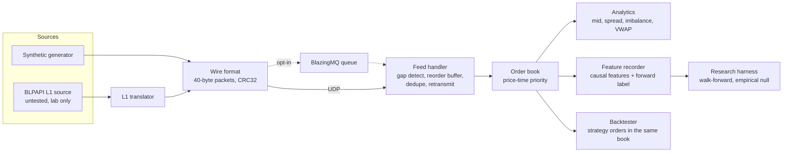

# lobster — limit order book, sequenced feed handler, backtester

A C++17 market-microstructure stack: a price-time-priority limit order book, a feed handler that
stays correct under packet loss / duplication / reordering, a causal feature recorder, an
event-driven backtester, and a Python research harness with leakage controls. No dependencies
beyond a C++17 compiler and CMake (numpy + pandas for the research tool).



## Numbers

Measured on a 4-vCPU cloud container, Release build, synthetic data, with nothing else running. The VM is noisy, so the table gives the median and range of five runs. Treat them as indicative; rerun on your machine.

| | result |
|---|---|
| Order book, 2M mixed ops (30% cancel, ~5% market, IOC) | **2.7 M ops/s** median of 5 runs (range 2.4 to 3.1); latency p50 223 ns, p90 912 ns, p99 2.0 µs, p99.9 5.4 µs (the median run) |
| Feed pipeline, 1M messages, 2% loss + 1% dup + local reorder | **1.9 M msgs/s** median of 5 runs (range 1.7 to 2.2); 27,171 duplicates dropped, 37,473 retransmits, book identical to the clean stream |

Latency percentiles are per-operation wall-clock including timer overhead; the max (~10 ms) is
scheduler noise on a shared VM, not the book.

## What is verified

- **Matching:** scenario tests plus differential fuzzing against a brute-force reference book
  (8 seeds x 20,000 ops).
- **Feed handler:** with up to 10% loss, the rebuilt book equals the book built from the clean stream;
  an unrecoverable gap stalls instead of silently skipping. The same property holds end-to-end over real
  loopback UDP, with garbage datagrams rejected.
- **Wire format:** every single-bit flip and every truncation is rejected.
- **Feature recorder:** labels are exactly `mid[i+h] - mid[i]`; features computed on a truncated stream
  equal the full-run values (no lookahead).
- **Backtester:** exact accounting on scripted feeds, latency timing, queue position, maker rebate,
  position limit, deterministic replay, and no-lookahead (prefix runs reproduce the equity curve).
- **Research harness:** self-test finds a planted signal 30/30 times and produces 0/30 false positives
  on both pure noise and a shifted-label control.
- All tests also pass under ASan + UBSan and with both g++ and clang++ (see CI).

## What the results do and do not show

This is infrastructure, and the data is synthetic. Read the findings accordingly.

- The research harness finds the top-of-book imbalance statistically predictive of the next mid move
  (IC +0.25, p = 0.048, the smallest value 20 shifts allow) — but R² against a zero predictor is slightly
  negative, and the backtest of the obvious strategy **loses money even before fees**: the expected move is
  smaller than the cost of crossing the spread. See `docs/research_report_synthetic.md` and `docs/backtest_results.md`.
- The market-maker backtest is profitable only because the synthetic flow is uninformed, so there is no
  adverse selection. That is a property of the generator, not an edge.
- The replayed feed does not react to the strategy's orders (no market impact).
- The Bloomberg source (`src/blpapi_source.cpp`) has **never been compiled or run against a Terminal**;
  it needs the BLPAPI SDK from Bloomberg and a logged-in Terminal. It produces an L1 (best bid/ask + trades)
  reconstruction, not a full-depth book. The tick translator behind it is unit-tested.

## Build and run

```bash
cmake -S . -B build && cmake --build build -j
ctest --test-dir build --output-on-failure

./build/lob_bench                 # order-book throughput and latency
./build/pipeline 1000000 snap.csv # feed handler under impairment, CSV snapshots
./build/backtest 1000000 10 42    # <messages> <latency in messages> <seed>
./build/record_features 1000000 features.csv
python3 tools/research.py features.csv --horizon 50
python3 tools/research.py --selftest
```

Sanitizers: `cmake -S . -B build-san -DCMAKE_BUILD_TYPE=Debug -DLOB_SANITIZE=ON`.
Live Bloomberg source: `-DLOB_WITH_BLPAPI=ON -DBLPAPI_ROOT=/path/to/blpapi_cpp`.
BlazingMQ transport: `-DLOB_WITH_BMQ=ON -DBMQ_ROOT=/path/to/blazingmq` (needs a built BlazingMQ tree; see `docs/blazingmq.md`).

## Layout

| path | what |
|---|---|
| `include/lob/order_book.hpp`, `src/order_book.cpp` | matching engine: limit/market, GTC/IOC/FOK, cancel, modify |
| `include/lob/feed.hpp` | synthetic feed, impairment channel, `FeedHandler`, `Analytics` |
| `include/lob/wire.hpp`, `transport.hpp` | binary packets and UDP transport |
| `include/lob/source.hpp`, `bbg_translate.hpp`, `src/blpapi_source.*` | source interface, Bloomberg L1 adapter |
| `examples/bmq_publish.cpp`, `bmq_consume.cpp` | opt-in BlazingMQ transport, see `docs/blazingmq.md` |
| `include/lob/features.hpp` | causal feature recorder |
| `include/lob/backtest.hpp` | event-driven backtester and example strategies |
| `tools/research.py` | walk-forward research harness |
| `tools/to_excel.py`, `tools/bbg_fetch.py` | CSV to Excel; blpapi historical-data fetch (untested) |

## Design notes

- **Book:** `std::map` of price levels (bids descending), a `std::list` FIFO per level, and an
  `unordered_map` id index so cancel is O(log p). Trades execute at the resting order's price.
  A modify keeps priority only for a same-price quantity reduction.
- **Feed handler:** out-of-order packets wait in an ordered buffer; once it exceeds a tolerance the handler
  asks the retransmit service for the missing range. Heartbeats carry the sender's last sequence so tail loss
  is detected too.
- **Backtester:** strategy orders enter the same book as the feed, so queue position comes from the matching
  engine rather than a fill heuristic. Actions take effect a fixed number of messages after the decision.
