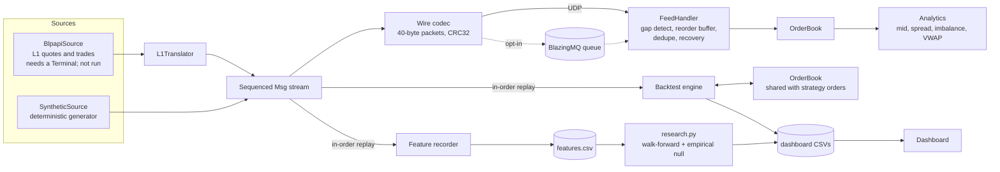

# Architecture

This document describes how the project is put together, why it is shaped this way, and where its limits are.
Every claim here can be checked against the code or a test; `VERIFICATION.md` maps claims to tests, and
`KNOWN_ISSUES.md` lists what is not solved.

## 1. Purpose and scope

Lobster is a market-microstructure stack in C++17 with a Python research layer. It does five things:

1. Matches orders in a **limit order book** with price-time priority.
2. Keeps that book correct while consuming a **sequenced feed** that can lose, duplicate and reorder packets.
3. **Records causal features** from the book and tests, with leakage controls, whether they predict the next price move.
4. **Backtests strategies** whose orders enter the same book as the replayed feed.
5. **Reports** all of the above on a dashboard.

It is research and infrastructure code. It is not a trading system: nothing here sends orders to a venue, and every
result in the repository comes from a deterministic synthetic feed (see section 9).

## 2. System context

Two paths consume the same message type, `lob::Msg`:

- The **live path** (wire, transport, handler, book) is built for unreliable delivery and is where correctness under
  loss matters.
- The **replay path** (recorder, backtester) reads an already-ordered stream, so it cannot lose messages by
  construction. It exists to run experiments quickly and deterministically.

## 3. Components

| Component | Files | Responsibility | Depends on |
|---|---|---|---|
| Order book | `include/lob/order_book.hpp`, `src/order_book.cpp` | Matching, cancel, modify, depth queries | nothing |
| Feed model | `include/lob/feed.hpp` | `Msg`, synthetic generator, impairment channel, `FeedHandler`, `Analytics` | order book |
| Source interface | `include/lob/source.hpp` | `MarketDataSource` abstraction, `SyntheticSource` | feed |
| Wire codec | `include/lob/wire.hpp` | Fixed 40-byte little-endian packets with CRC32 | feed |
| UDP transport | `include/lob/transport.hpp` | Unicast sockets, poll-based receive | wire |
| L1 translator | `include/lob/bbg_translate.hpp` | Bloomberg-style quote/trade ticks to `Msg` | feed |
| Bloomberg source | `src/blpapi_source.{hpp,cpp}` | `//blp/mktdata` subscription (opt-in build) | translator, BLPAPI SDK |
| Feature recorder | `include/lob/features.hpp` | Causal features plus forward-mid label | feed |
| Backtester | `include/lob/backtest.hpp` | Event-driven engine, gateway, two example strategies | feed |
| BlazingMQ tools | `examples/bmq_{publish,consume}.cpp` | Queue transport for wire packets (opt-in build) | wire, BlazingMQ |
| Research harness | `tools/research.py` | Walk-forward evaluation with an empirical null | numpy, pandas |
| Dashboard | `dashboard/` , `tools/dashboard_data.py` | Page source and the datasets behind it | all of the above |

Everything is header-only except `src/order_book.cpp` and the optional Bloomberg source. Dependencies point one way
(down the table); the order book knows nothing about feeds, and nothing in `include/lob` knows about the research
code or the dashboard.

## 4. Data flow

### 4.1 Live path

1. A source yields `Msg{kind, seq, order|id}` with a gapless sequence number starting at 1.
2. The wire codec packs each into 40 bytes. The transport sends it over UDP or posts it to a BlazingMQ queue.
3. The receiver decodes each datagram. Corrupt, short or unknown packets are dropped and counted, never applied.
4. `FeedHandler::on_packet` applies the message if it is the next expected sequence, buffers it if it is ahead,
   and counts it as a duplicate if it is behind or already buffered.
5. Applying a message submits or cancels on the `OrderBook`; resulting trades feed `Analytics`.

### 4.2 Replay path: features and research

`record_features` replays an ordered stream through its own book and samples every 10 messages once the book is
two-sided. A row holds spread, top-1 and top-5 imbalance, microprice deviation, signed trade flow over the last 200
messages, and depth on each side. The label is the mid change 50 samples ahead and is attached after the fact; it is
the only forward-looking column. `tools/research.py` consumes the CSV.

### 4.3 Replay path: backtesting

For each feed message the engine (1) releases strategy actions that are due, (2) applies the message to the book and
books any fills involving strategy orders, (3) updates the mid, (4) calls the strategy with a read-only `View`.
Strategy orders get ids from `2^60` upward so they never collide with feed ids, and they rest in the same book, so
queue position comes from the matching engine and not from a fill heuristic.

## 5. Invariants

These are the properties the code is designed to keep. `VERIFICATION.md` says which ones a test checks directly,
which only indirectly, and which not at all.

**Order book**
- Orders at the best price on the opposite side fill first, oldest first. Trades print at the resting order's price.
- `index_` contains exactly the resting orders, and each level's `total` equals the sum of its queue. (Checked
  indirectly, through resting-order counts and trade-for-trade equality with a reference book; not asserted directly.)
- A market order never rests. IOC never rests. FOK either fills completely or changes nothing.
- A modify keeps queue priority only for a same-price quantity reduction; any other change re-enters as a new GTC
  limit order and may match. (Covered by scenario tests only; the fuzz test does not issue modifies.)

**Feed handler**
- Messages are applied exactly once, in sequence order, with no gaps. `applied` equals the sequence reached minus one.
- If a gap cannot be recovered, the handler stops at the gap. It never skips a sequence number silently.
- Once the buffer holds more than `tolerance` (default 16) out-of-order messages, it asks the retransmit callback for
  the missing range. A heartbeat carrying the sender's last sequence triggers the same recovery, which catches
  tail loss.

**Wire format**
- A packet is exactly 40 bytes with magic `0x4C42`, version 1 and a CRC32 over the first 36 bytes. Decoding rejects
  any single-bit flip, any truncation and out-of-range enum values.

**Features and research**
- A feature row depends only on messages up to its own sequence number.
- Each walk-forward training set ends at least `horizon` samples before its test block.

**Backtester**
- Replays are bit-for-bit repeatable, and a run on a prefix of a feed reproduces the first part of the full run's
  equity curve. Position never exceeds the configured limit, counting open orders.

## 6. Design decisions

| # | Decision | Alternatives considered | Consequence |
|---|---|---|---|
| 1 | `std::map` price levels, `std::list` FIFO per level, `unordered_map` id index | Flat arrays indexed by tick, intrusive lists, a slab allocator | Simple and obviously correct; cancel is O(log levels). It pays for it in pointer chasing and one allocation per resting order, which bounds throughput at a few million ops per second. A tick-indexed array would be faster for tight price ranges and is the first optimisation to try. |
| 2 | Single-threaded deterministic core; concurrency only at the edges | Lock-free SPSC queue between feed and strategy threads | Determinism makes tests and replays exact. There is no lock-free queue in the repository, even though an earlier plan listed one. The BlazingMQ client runs its own threads and hands messages over on the calling thread. |
| 3 | Recovery through a `Retransmit` callback | A NACK protocol over UDP; an in-band snapshot | Keeps the handler testable and transport-agnostic. The UDP transport has no return channel, so real network retransmission is not implemented; tests supply the callback from an in-process copy of the feed. |
| 4 | Fixed 40-byte binary packets with CRC32 | Protobuf, SBE, JSON | No allocation or schema step, trivially fuzzable. The format is private to this project and not versioned beyond a version byte. |
| 5 | Strategy orders enter the same book as the feed | A fill model driven by trade prints | Queue position and cancel races come out of the engine. The cost is that the replayed feed ignores our orders, so there is no market impact. |
| 6 | Bloomberg L1 mapped to one synthetic resting order per side | Treating each quote update as an independent order | Keeps the book consistent when quotes change. It is a top-of-book reconstruction, not depth, and the documentation says so wherever it appears. |
| 7 | Significance from an empirical null (20 circular label shifts), bootstrap interval secondary | i.i.d. confidence intervals, a plain permutation test | Circular shifts preserve label autocorrelation, which made a block bootstrap too narrow on persistent features. The smallest reportable p-value is 1/21, about 0.048. |
| 8 | BlazingMQ is an opt-in build | A required dependency | The build takes about an hour, so CI skips it. The default build needs only a C++17 compiler and CMake. |

## 7. Failure modes

| Failure | Handling | Verified by |
|---|---|---|
| Packet loss, duplication, local reordering | Buffer, dedupe, recover via callback | `feed_tests`, `wire_tests` (loopback UDP) |
| Tail loss (final packets dropped) | Heartbeat carries the sender's last sequence | `feed_tests`, `wire_tests` |
| Corrupt or truncated datagram | CRC and field checks reject it; counted, never applied | `wire_tests` |
| Unrecoverable gap | Handler stops at the gap | `feed_tests` |
| Duplicate order id | Book rejects with `DuplicateId` | `order_book` tests |
| Crossed or locked Bloomberg quote | Dropped; cached state is left unchanged | `bbg_translate_tests` |
| Broker queue full (BlazingMQ) | Broker rejects the post; handler fills the gap through the callback | End-to-end run in `docs/blazingmq.md` |
| Strategy exceeds position limit | Order rejected at activation | `backtest_tests` |

## 8. Concurrency

The core (book, handler, recorder, backtester) is single-threaded and not thread-safe. `UdpSocket` is used from
one thread. The BlazingMQ publisher and consumer call into the BlazingMQ client, which manages its own threads;
messages are processed on the thread that calls `nextEvent`. Anything that needs several threads should put a queue
between them rather than share a book.

## 9. Data and what it can support

All results come from `generate_feed`, a seeded generator that places orders around a random-walk mid with a fixed
cancel rate and 5% market orders. It has no informed traders and no market regimes, and it leaves stale orders
behind as the mid moves, so the book drifts into a wide spread late in a long run. Consequences:

- A passive market-making strategy looks profitable because nothing trades against better information.
- Raw level features (spread, depth) are not stationary; the research harness uses only stationary transforms.
- None of the results say anything about a real market. They test that the machinery is correct.

## 10. Performance

`bench/bench.cpp` replays two million pre-generated mixed operations and records per-operation latency;
`examples/pipeline.cpp` runs one million messages through impairment and the handler. Numbers and their spread are
in the README. The measuring VM is shared and noisy: medians moved by about 25% between sessions, so treat figures as
indicative and rerun them on the target machine. Latency includes timer overhead and the maximum is scheduler noise.

## 11. Extension points

- **New data source:** implement `MarketDataSource::next()` and emit `Msg` with gapless sequence numbers. The
  Bloomberg adapter follows this shape.
- **New strategy:** subclass `Strategy`, read the `View`, send orders through the `Gateway`. Actions take effect
  `latency` messages later.
- **New feature:** add a column to `FeatureRow`, compute it from state available at the sample point, extend the
  prefix-equality test, and add it to `FEATURES` in `research.py` only if it is stationary.
- **New transport:** produce and consume `wire::Packet`; the handler needs nothing else.

## 12. Non-goals

Multiple instruments, order entry to a venue, a risk system, persistence, a full depth feed from Bloomberg, and any
claim of profitability.
